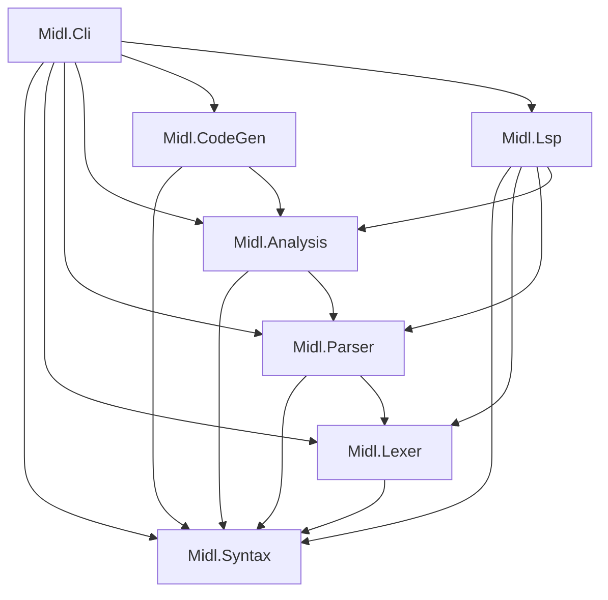

# Contributing to the MIDL Compiler Rewrite

Thank you for your interest in contributing to the MIDL compiler rewrite! This guide covers everything you need to get started, from building the project to submitting pull requests.

## Contributor License Agreement

This project welcomes contributions and suggestions. Most contributions require you to agree to a
Contributor License Agreement (CLA) declaring that you have the right to, and actually do, grant us
the rights to use your contribution. For details, visit https://cla.opensource.microsoft.com.

When you submit a pull request, a CLA bot will automatically determine whether you need to provide
a CLA and decorate the PR appropriately (e.g., status check, comment). Simply follow the instructions
provided by the bot. You will only need to do this once across all repos using our CLA.

This project has adopted the [Microsoft Open Source Code of Conduct](https://opensource.microsoft.com/codeofconduct/).
For more information see the [Code of Conduct FAQ](https://opensource.microsoft.com/codeofconduct/faq/) or
contact [opencode@microsoft.com](mailto:opencode@microsoft.com) with any additional questions or comments.

## Getting Started

### Prerequisites

| Tool | Version | Purpose |
|------|---------|---------|
| [.NET 10 SDK](https://dotnet.microsoft.com/) | 10.0.102+ | Build and test the compiler |
| [Node.js](https://nodejs.org/) | LTS | VS Code extension development |
| [VS Code](https://code.visualstudio.com/) | Latest | Extension testing and development |

### Clone and Build

```bash
git clone https://github.com/microsoft/midl
cd midl
dotnet build
```

### Run Tests

```bash
# Run all tests
dotnet test

# Run a single test project
dotnet test tests/Midl.Parser.Tests

# Run a specific test by name
dotnet test --filter "FullyQualifiedName~ParseNamespace"
```

The test suite uses **xUnit** as the test framework and **Verify** for snapshot-based assertion testing.

## Project Architecture

For a comprehensive overview, see [docs/architecture.md](docs/architecture.md).

The compiler is organized into seven `src/` projects, each with a clear responsibility:

| Project | Role |
|---------|------|
| **Midl.Syntax** | Shared syntax tree types, `SyntaxKind`, node definitions |
| **Midl.Lexer** | Tokenization of MIDL source text |
| **Midl.Parser** | Builds a lossless concrete syntax tree from tokens |
| **Midl.Analysis** | Semantic analysis — symbols, binding, diagnostics |
| **Midl.CodeGen** | Emits WinMD metadata from the semantic model |
| **Midl.Lsp** | Language Server Protocol implementation |
| **Midl.Cli** | Command-line entry point tying everything together |

### Dependency Graph



## Coding Conventions

### Language and Framework

- **C# 14 / .NET 10** features are encouraged — use records, pattern matching, collection expressions, and other modern idioms where they improve clarity.
- **Nullable reference types** are enabled project-wide. Do not add `!` suppressions without a comment justifying why.
- **`TreatWarningsAsErrors`** is on. Fix all warnings; do not suppress them.

### Style

- **File-scoped namespaces** preferred (`namespace Midl.Parser;` rather than a block).
- **One primary type per file.** Keep files focused on a single responsibility.
- **XML doc comments** on all public APIs.

### Naming

| Element | Convention | Example |
|---------|-----------|---------|
| Public members | PascalCase | `SyntaxKind`, `ParseExpression()` |
| Local variables | camelCase | `tokenIndex`, `currentNode` |
| Private fields | _camelCase | `_diagnostics`, `_position` |

## Adding New Syntax

When adding support for a new MIDL language construct, follow these steps in order:

1. **Add `SyntaxKind` entries** in `Midl.Syntax/SyntaxKind.cs` — add token kinds, node kinds, or both as needed.

2. **Add the keyword** (if applicable) in `Midl.Lexer/KeywordTable.cs` so the lexer recognizes it.

3. **Add a parser method** in the appropriate `Parser.*.cs` partial file. Follow existing patterns for error recovery (see [Key Design Decisions](#key-design-decisions-to-preserve)).

4. **Add a symbol type** in `Midl.Analysis/Symbols/` to represent the construct in the semantic model.

5. **Update `Binder.cs`** to create the new symbol from the parsed syntax node.

6. **Add codegen support** in the relevant emitter to produce WinMD output for the construct.

7. **Add tests at every layer:**
   - Lexer → token kinds and text
   - Parser → tree structure
   - Analysis → symbols and diagnostics
   - CodeGen → emit and round-trip

## Adding New Tests

Each compiler layer has its own test patterns:

### Lexer Tests
Verify that input text produces the expected token kinds and token text.

### Parser Tests
Verify tree structure by checking `SyntaxKind` of nodes. Ensure the tree is **lossless** — every byte of input must be accounted for in the tree.

### Analysis Tests
Use `CompilationHelper.Compile()` to build a semantic model, then check symbols and diagnostics.

### CodeGen Tests
Compile source → emit WinMD → read back the metadata → assert correctness. This round-trip pattern catches serialization bugs.

### Integration Tests
Exercise end-to-end flows through the CLI or LSP request handlers.

### Error Recovery Tests
Feed the parser deliberately malformed input and verify:
- The parser does **not** crash.
- The resulting tree contains appropriate `MissingToken` and `SkippedTokens` error nodes.
- Valid portions of the input are still parsed correctly.

## Pull Request Process

Before submitting a PR, ensure:

- [ ] **All tests pass** — `dotnet test` exits cleanly.
- [ ] **Build is warning-free** — `TreatWarningsAsErrors` must not be violated.
- [ ] **New features have tests** — no untested code paths.
- [ ] **Parser changes include error recovery tests** — malformed input must not crash.
- [ ] **WinMD changes include round-trip tests** — emit → read-back → assert.
- [ ] **PR is focused** — one feature or fix per PR. Split unrelated changes into separate PRs.

## Key Design Decisions to Preserve

These invariants are foundational to the compiler's design. All contributions must uphold them.

### Lossless Syntax Tree
Every byte of the original source text must be represented in the syntax tree. Never discard trivia (whitespace, newlines), comments, or error tokens. A round-trip from tree back to text must reproduce the original source exactly.

### Error Recovery
The parser must **never crash**, regardless of input. It must always produce a syntax tree. Use `MissingToken` nodes for expected-but-absent tokens and `SkippedTokens` nodes for unexpected input that cannot be parsed.

### No External NuGet for LSP
The LSP implementation uses pure `System.Text.Json` over stdio. This keeps the server compatible with **NativeAOT** compilation. Do not introduce external LSP libraries.

### System.Reflection.Metadata for WinMD
All WinMD metadata reading and writing uses `System.Reflection.Metadata`. Do not introduce COM interop dependencies for metadata operations.

## Known Gaps / Good First Issues

Looking for a place to start? These are well-scoped tasks from the project plan:

| Task | Description |
|------|-------------|
| **Missing reserved keywords** | Add the ~140 remaining reserved keywords to `KeywordTable.cs`. The MIDL spec lists them; the lexer doesn't recognize them all yet. |
| **Unicode identifier validation** | Implement Unicode 3.0 category checks for MIDL identifiers. Currently only ASCII identifiers are validated. |
| **Struct field type validation** | Enforce that struct fields use only value types. The analysis layer doesn't check this constraint yet. |
| **Contract history validation** | Implement diagnostic MIDL5132 — validate that contract version history is consistent and monotonically increasing. |
| **Interface synthesization** | Generate synthetic interfaces (`I<Class>`, `I<Class>Factory`, etc.) for runtime classes during analysis and codegen. |

Pick one, open an issue to claim it, and submit a PR when you're ready. We're happy to help with questions along the way!
