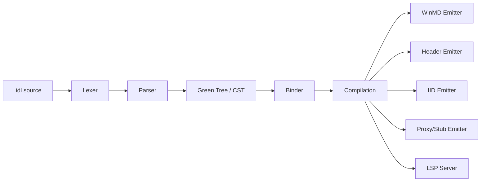

# MIDL — Microsoft Interface Definition Language Compiler

A modern, incremental, editor-friendly rewrite of the MIDL compiler in C# / .NET 10.

---

## Overview

This project is a **ground-up rewrite** of the Microsoft Interface Definition Language (MIDL) compiler. It targets modern C# and .NET 10, replacing the legacy native-code compiler with a fully managed implementation built around a Roslyn-style architecture.

| Goal | Description |
|------|-------------|
| **Primary** | 100 % MIDL3 syntax parity with an error-recovering parser designed for LSP / editor integration |
| **Secondary** | Best-effort classic MIDL support |

### Outputs

| Artifact | Extension |
|----------|-----------|
| Windows Metadata | `.winmd` |
| C / C++ headers | `.h` |
| IID definitions | `_i.c` |
| Custom proxy/stub | `_proxy.cpp` |
| DllData | `dlldata.c` |
| Proxy / stub skeletons | `_p.c` |

The project also ships a **Language Server Protocol (LSP) server** and a **VS Code extension** for real-time diagnostics, completions, hover info, and more.

---

## Quick Start

```bash
# Build
dotnet build

# Run tests
dotnet test

# Compile a MIDL file (header + IIDs)
dotnet run --project src/Midl.Cli -- /winrt /h output.h /iid output_i.c input.idl

# Generate Windows Metadata
dotnet run --project src/Midl.Cli -- /winmd output.winmd input.idl

# Generate proxy/stub code for COM marshaling
dotnet run --project src/Midl.Cli -- /winrt /h Widget.h /iid Widget_i.c /cppproxy Widget_proxy.cpp Widget.idl

# Decompile a .winmd back to IDL
dotnet run --project src/Midl.Cli -- --decompile output.winmd

# Syntax check only
dotnet run --project src/Midl.Cli -- /Zs input.idl

# Start LSP server
dotnet run --project src/Midl.Cli -- --lsp
```

---

## Project Structure

| Directory | Purpose |
|-----------|---------|
| `src/Midl.Syntax` | Syntax kinds, red-green tree infrastructure |
| `src/Midl.Lexer` | Error-tolerant tokenizer (60+ keywords) |
| `src/Midl.Parser` | Error-recovering recursive-descent parser |
| `src/Midl.Analysis` | Semantic analysis, symbol table, WinMD reader |
| `src/Midl.CodeGen` | Output backends (WinMD, headers, IIDs, stubs) |
| `src/Midl.Lsp` | Language Server Protocol server |
| `src/Midl.Cli` | Command-line interface (30+ switches) |
| `editors/vscode` | VS Code extension (TextMate grammar + LSP client) |
| `tests/` | 5 test projects, 2200+ tests |
| `docs/` | Architecture, testing, diagnostics, winmidl.json guides |

---

## Architecture Overview

The compiler follows a **Roslyn-style red-green syntax tree** design. The green tree is an immutable, fully-faithful concrete syntax tree (CST) that preserves every token and trivia from the source file. A thin red-tree wrapper adds parent pointers and absolute positions on demand.

Key design choices:

- **Error recovery** — the parser never throws; it inserts missing tokens and skips unexpected ones so that every input produces a complete tree.
- **WinMD emission** — built on `System.Reflection.Metadata` for zero-dependency metadata writing.
- **LSP over stdio** — the same binary serves as both a CLI compiler and a language server.

> For a deep dive see [docs/architecture.md](docs/architecture.md).

### Compilation Pipeline



---

## Supported MIDL3 Syntax

The parser currently handles the following MIDL3 constructs:

- **Namespaces** — nested and dotted
- **Runtime classes** — `static`, `partial`, `unsealed`, base types, interface `requires`
- **Interfaces** — including `requires` clauses
- **Delegates**
- **Structs** and **enums** (including `[flags]`)
- **API contracts**
- **Events**, **properties**, and **constructors**
- **Versioned blocks** (`contract`)
- **Generics** — parameterized interfaces and delegates
- **Modern built-in types** — `String`, `Boolean`, `Int32`, `IVector<T>`, etc.
- **Custom attributes**

> See [PLAN.md](PLAN.md) for the full 91-feature implementation catalog.

---

## VS Code Extension

The `editors/vscode` directory contains a VS Code extension that bundles:

- **TextMate grammar** for MIDL syntax highlighting
- **LSP client** that communicates with the compiler's built-in language server

### Features

| Feature | Status |
|---------|--------|
| Syntax highlighting | ✅ |
| Real-time diagnostics | ✅ |
| Completions | ✅ |
| Hover information | ✅ |
| Go-to-definition | ✅ |
| Signature help | ✅ |
| Semantic tokens | ✅ |
| Code folding | ✅ |
| Formatting | ✅ |

### Install

```bash
cd editors/vscode
npm install
npm run build
code --install-extension midl-*.vsix
```

> See [docs/testing.md](docs/testing.md) for detailed build and test instructions.

---

## Command-Line Usage

```
dotnet run --project src/Midl.Cli -- [switches] <input.idl>
```

### Key Switches

| Switch | Description |
|--------|-------------|
| `/winrt` | Enable Windows Runtime (MIDL3) mode |
| `/winmd <file>` | Emit Windows Metadata (`.winmd`) |
| `/cppproxy <file>` | Emit custom proxy/stub C++ code |
| `/h <file>` | Emit C/C++ header |
| `/iid <file>` | Emit IID definitions (`_i.c`) |
| `/out <dir>` | Set output directory |
| `/reference <.winmd>` | Add a WinMD reference |
| `/Zs` | Syntax check only — no output files |
| `/W<n>` | Set warning level |
| `/WX` | Treat warnings as errors |
| `/D <name>=<val>` | Define a preprocessor macro |
| `/I <dir>` | Add an include search path |
| `--lsp` | Start as an LSP server (stdio) |
| `/?` | Show full help |
| `/nologo` | Suppress the banner |

---

## Generating Windows Metadata (WinMD)

Use the `/winmd` switch to emit a `.winmd` file from your IDL:

```bash
# Generate a .winmd file (implicitly enables /winrt mode)
dotnet run --project src/Midl.Cli -- /winmd output.winmd input.idl

# Generate both header and WinMD
dotnet run --project src/Midl.Cli -- /winrt /h output.h /winmd output.winmd input.idl
```

The emitter uses `System.Reflection.Metadata` to produce spec-compliant WinMD files with:

- **Full attribute emission** — `[contract]`, `[activatable]`, `[composable]`, `[static]`, `[deprecated]`, `[threading]`, `[marshaling_behavior]`, `[version]`, `[experimental]`, `[noexcept]`, `[remote_async]`, `[attributeusage]`, and user-defined attributes
- **Correct version encoding** — integer versions encoded as `(major << 16) | minor`, hex passthrough, `major.minor` notation
- **ApiContract types** — emitted as structs with `[ApiContract]` and `[ContractVersion]` attributes
- **Custom attribute types** — emitted with `[AttributeUsageAttribute]` using CLR `System.AttributeTargets` flags (matching MIDL.exe behavior)
- **Deterministic GUIDs** — synthesized interfaces get stable UUIDs derived from their ABI signature

### Inspecting WinMD Files

```bash
# Dump metadata tables (types, methods, attributes)
dotnet run --project src/Midl.Cli -- --dump-winmd output.winmd

# Decompile back to IDL
dotnet run --project src/Midl.Cli -- --decompile output.winmd
```

---

## Custom Proxy/Stub Code Generation

WinMIDL can generate custom C++ proxy/stub code for COM marshaling, replacing the traditional MIDL-generated NDR stubs with compiled, type-safe serialization.

```bash
# Generate header, IID file, and proxy/stub C++ code
dotnet run --project src/Midl.Cli -- /winrt /h Widget.h /iid Widget_i.c /cppproxy Widget_proxy.cpp Widget.idl
```

### What's Generated

| File | Content |
|------|---------|
| `Widget.h` | C/C++ header with interface declarations |
| `Widget_i.c` | GUIDs (IIDs, CLSIDs) |
| `Widget_proxy.cpp` | Proxy and stub implementations for cross-apartment/cross-process marshaling |

### Building a Proxy/Stub DLL

The generated proxy code compiles into a standard COM proxy/stub DLL:

```bash
# Compile the proxy/stub DLL (MSVC)
cl /nologo /std:c++latest /EHsc /LD ^
    Widget_proxy.cpp Widget_i.c dlldata.c ^
    /I path/to/winmidl/include ^
    ole32.lib oleaut32.lib rpcrt4.lib ^
    /link /DEF:proxy.def /OUT:Widget_proxy.dll

# Register for in-process marshaling
regsvr32 Widget_proxy.dll
```

### Runtime Headers

The proxy code depends on `include/winmidl/proxy_helpers.h` which provides:

- Zero-copy `GetRuntimeClassName` using `WindowsCreateStringReference`
- `marshal_interface` / `unmarshal_interface` with typed IID + `IID_IUnknown` fallback
- HSTRING serialization helpers
- `EventRegistrationToken` marshaling
- Struct and array serialization

### Supported Marshaling Patterns

- **Primitives** — all WinRT value types, HSTRING, GUID, EventRegistrationToken
- **Structs** — nested structs with correct alignment
- **Interfaces** — with typed IID marshaling and `IID_IUnknown` fallback for system objects
- **Delegates** — typed callback proxies with event registration
- **Enums and flags**
- **Out parameters** — including interface out params with cleanup
- **Properties** — get/set with full round-trip
- **Events** — add/remove with `EventRegistrationToken`
- **Multiple interfaces** — QI, `GetIids`, inheritance chains

> See [docs/marshaling-architecture.md](docs/marshaling-architecture.md) and [docs/wire-format-spec.md](docs/wire-format-spec.md) for the full design.

---

## Project Configuration (`winmidl.json`)

For multi-file projects, create a `winmidl.json` in your project root to configure cross-file compilation:

```jsonc
{
    "inputs": ["src/Widget.idl", "src/Helper.idl"],
    "references": ["lib/MyLibrary.winmd"],
    "defines": ["FEATURE_X"],
    "includePaths": ["include"],
    "noSdk": false
}
```

The LSP discovers this file automatically, enabling cross-file symbol resolution, autocomplete, and diagnostics. For lightweight per-file hints, use `// @ref: other.idl` at the top of your source.

> See [docs/winmidl-json.md](docs/winmidl-json.md) for the full specification.

---

## Links

- [Architecture](docs/architecture.md)
- [Marshaling Architecture](docs/marshaling-architecture.md)
- [Wire Format Spec](docs/wire-format-spec.md)
- [Diagnostics Reference](docs/diagnostics.md)
- [Project Configuration (winmidl.json)](docs/winmidl-json.md)
- [Testing Guide](docs/testing.md)
- [Contributing](CONTRIBUTING.md)
- [Implementation Plan](PLAN.md)
- [MIDL3 Documentation](https://learn.microsoft.com/en-us/uwp/midl-3/)

---

## License

© Microsoft Corporation. All rights reserved.
