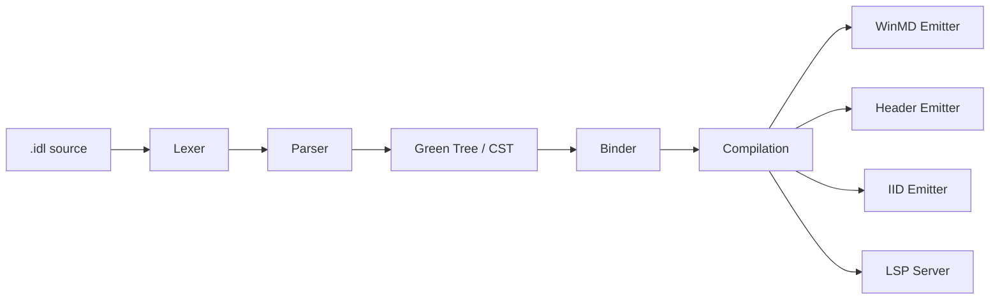

# MIDL — Microsoft Interface Definition Language Compiler

A modern, incremental, editor-friendly rewrite of the MIDL compiler in C# / .NET 10.

---

## Overview

This project is a **ground-up rewrite** of the Microsoft Interface Definition Language (MIDL) compiler. It targets modern C# and .NET 10, replacing the legacy native-code compiler with a fully managed implementation built around a Roslyn-style architecture.

| Goal | Description |
|------|-------------|
| **Primary** | 100 % MIDL3 syntax parity with an error-recovering parser designed for LSP / editor integration |
| **Secondary** | Best-effort classic MIDL support |

### Outputs

| Artifact | Extension |
|----------|-----------|
| Windows Metadata | `.winmd` |
| C / C++ headers | `.h` |
| IID definitions | `_i.c` |
| DllData | `dlldata.c` |
| Proxy / stub skeletons | `_p.c` |

The project also ships a **Language Server Protocol (LSP) server** and a **VS Code extension** for real-time diagnostics, completions, hover info, and more.

---

## Quick Start

```bash
# Build
dotnet build

# Run tests
dotnet test

# Compile a MIDL file
dotnet run --project src/Midl.Cli -- /winrt /h output.h input.idl

# Start LSP server
dotnet run --project src/Midl.Cli -- --lsp

# Syntax check only
dotnet run --project src/Midl.Cli -- /Zs input.idl
```

---

## Project Structure

| Directory | Purpose |
|-----------|---------|
| `src/Midl.Syntax` | Syntax kinds, red-green tree infrastructure |
| `src/Midl.Lexer` | Error-tolerant tokenizer (60+ keywords) |
| `src/Midl.Parser` | Error-recovering recursive-descent parser |
| `src/Midl.Analysis` | Semantic analysis, symbol table, WinMD reader |
| `src/Midl.CodeGen` | Output backends (WinMD, headers, IIDs, stubs) |
| `src/Midl.Lsp` | Language Server Protocol server |
| `src/Midl.Cli` | Command-line interface (30+ switches) |
| `editors/vscode` | VS Code extension (TextMate grammar + LSP client) |
| `tests/` | 5 test projects, 104+ tests |
| `docs/` | Architecture, testing, contributing guides |

---

## Architecture Overview

The compiler follows a **Roslyn-style red-green syntax tree** design. The green tree is an immutable, fully-faithful concrete syntax tree (CST) that preserves every token and trivia from the source file. A thin red-tree wrapper adds parent pointers and absolute positions on demand.

Key design choices:

- **Error recovery** — the parser never throws; it inserts missing tokens and skips unexpected ones so that every input produces a complete tree.
- **WinMD emission** — built on `System.Reflection.Metadata` for zero-dependency metadata writing.
- **LSP over stdio** — the same binary serves as both a CLI compiler and a language server.

> For a deep dive see [docs/architecture.md](docs/architecture.md).

### Compilation Pipeline



---

## Supported MIDL3 Syntax

The parser currently handles the following MIDL3 constructs:

- **Namespaces** — nested and dotted
- **Runtime classes** — `static`, `partial`, `unsealed`, base types, interface `requires`
- **Interfaces** — including `requires` clauses
- **Delegates**
- **Structs** and **enums** (including `[flags]`)
- **API contracts**
- **Events**, **properties**, and **constructors**
- **Versioned blocks** (`contract`)
- **Generics** — parameterized interfaces and delegates
- **Modern built-in types** — `String`, `Boolean`, `Int32`, `IVector<T>`, etc.
- **Custom attributes**

> See [PLAN.md](PLAN.md) for the full 91-feature implementation catalog.

---

## VS Code Extension

The `editors/vscode` directory contains a VS Code extension that bundles:

- **TextMate grammar** for MIDL syntax highlighting
- **LSP client** that communicates with the compiler's built-in language server

### Features

| Feature | Status |
|---------|--------|
| Syntax highlighting | ✅ |
| Real-time diagnostics | ✅ |
| Completions | ✅ |
| Hover information | ✅ |
| Go-to-definition | ✅ |
| Semantic tokens | ✅ |
| Formatting | ✅ |

### Install

```bash
cd editors/vscode
npm install
npm run build
code --install-extension midl-*.vsix
```

> See [docs/testing.md](docs/testing.md) for detailed build and test instructions.

---

## Command-Line Usage

```
dotnet run --project src/Midl.Cli -- [switches] <input.idl>
```

### Key Switches

| Switch | Description |
|--------|-------------|
| `/winrt` | Enable Windows Runtime (MIDL3) mode |
| `/h <file>` | Emit C/C++ header |
| `/iid <file>` | Emit IID definitions (`_i.c`) |
| `/out <dir>` | Set output directory |
| `/reference <.winmd>` | Add a WinMD reference |
| `/Zs` | Syntax check only — no output files |
| `/W<n>` | Set warning level |
| `/WX` | Treat warnings as errors |
| `/D <name>=<val>` | Define a preprocessor macro |
| `/I <dir>` | Add an include search path |
| `--lsp` | Start as an LSP server (stdio) |
| `/?` | Show full help |
| `/nologo` | Suppress the banner |

---

## Links

- [Architecture](docs/architecture.md)
- [Testing Guide](docs/testing.md)
- [Contributing](CONTRIBUTING.md)
- [Implementation Plan](PLAN.md)
- [MIDL3 Documentation](https://learn.microsoft.com/en-us/uwp/midl-3/)

---

## License

© Microsoft Corporation. All rights reserved.
