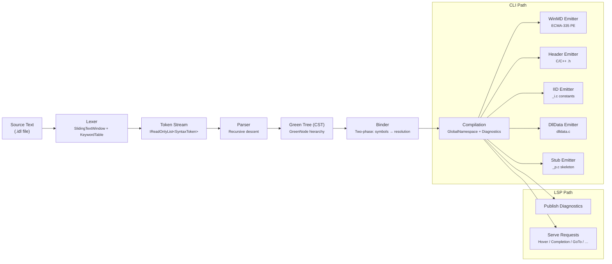
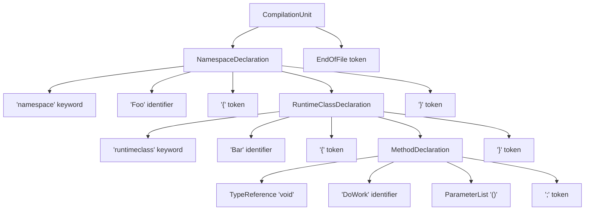
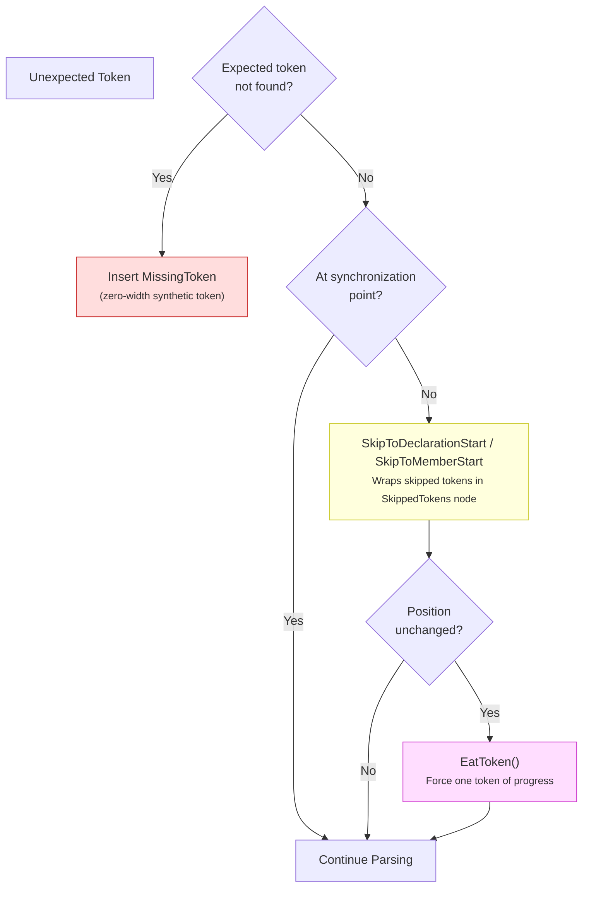
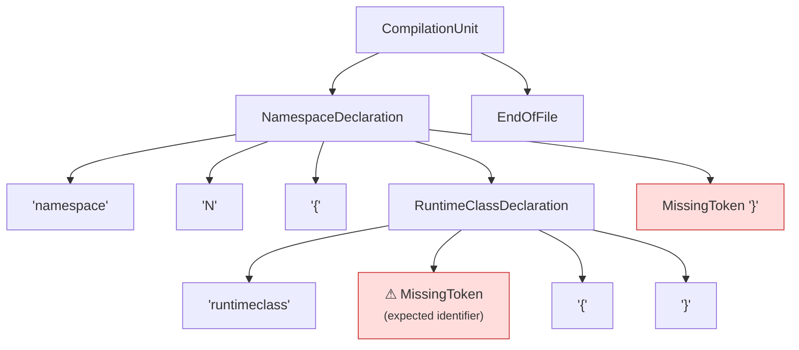
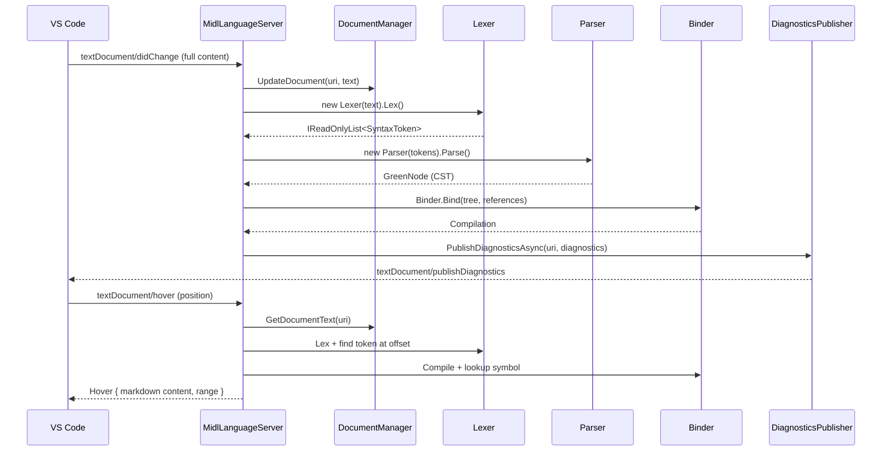
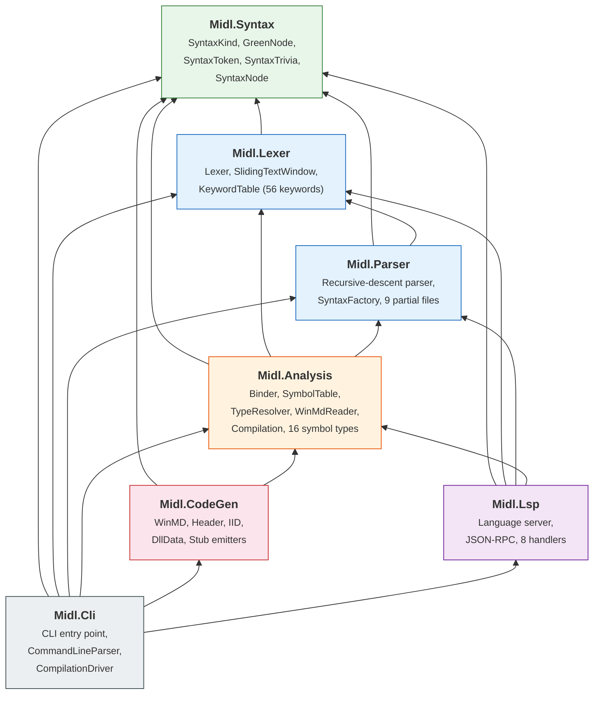

# MIDL Compiler Architecture

This document describes the internal architecture of the MIDL 4.0 compiler — a ground-up
rewrite of Microsoft's IDL compiler in C# targeting .NET 10. The compiler parses MIDL3 and
classic MIDL syntax, performs semantic analysis, and emits WinRT metadata (.winmd), C/C++
headers, IID constants, and proxy/stub skeletons. A built-in Language Server Protocol (LSP)
server provides real-time IDE support.

The design follows **Roslyn-inspired patterns**: an immutable red-green syntax tree, a
two-phase binder, and a symbol model that unifies user-defined types with externally
imported WinMD references.

---

## 1. Compilation Pipeline

Every compilation — whether driven by the CLI or the LSP server — follows the same
pipeline. The CLI path continues through code generation; the LSP path stops after binding
and publishes diagnostics instead.



**`CompilationHelper.Compile(source, references)`** is the shared entry point that
wires Lexer → Parser → Binder and returns a `Compilation` object.

---

## 2. Red-Green Syntax Tree

The most important architectural concept in this compiler is the **red-green tree**,
borrowed from the Roslyn compiler platform. It separates the immutable data
representation (green) from the navigable, position-aware view (red).

### Green Tree (`GreenNode`)

| Characteristic | Detail |
|---|---|
| Mutability | **Immutable** — never modified after construction |
| Parent pointers | **None** — enables structural sharing across incremental edits |
| Child access | Slot-based: `SlotCount` + `GetSlot(int index)` |
| Width tracking | `FullWidth` includes all trivia of descendant tokens |
| Missing detection | `IsMissing` is true when `FullWidth == 0` (excluding EOF) |

Concrete green node types:

- **`GreenNodeList`** (`SyntaxFactory.cs`) — composite node with a `SyntaxKind` and a
  `GreenNode?[]` children array. `FullWidth` is the sum of child widths.
- **`SyntaxToken`** — leaf node with `Text`, `Value`, `LeadingTrivia[]`, and
  `TrailingTrivia[]`. `SlotCount` is always 0.
- **`SyntaxTrivia`** — whitespace, comments, skipped tokens. Has `Text` and `FullWidth`.

### Red Tree (`SyntaxNode`)

| Characteristic | Detail |
|---|---|
| Mutability | Wrappers are created lazily but conceptually read-only |
| Parent pointers | `Parent` property — enables upward navigation |
| Position | `Position` — absolute character offset in source |
| Child creation | `GetChild(int index)` lazily wraps the green slot |

Position of child *i* is computed as:

```
child[i].Position = parent.Position + Σ(child[0..i-1].FullWidth)
```

### SyntaxToken and SyntaxTrivia

**Tokens** are the leaves of the tree. Each token carries:
- `Kind` — one of 209 `SyntaxKind` values (punctuation, keywords, literals, error)
- `Text` — the source text span
- `Value` — parsed value for literals (e.g., `42L` → `long 42`)
- `LeadingTrivia[]` — whitespace and comments *before* the token
- `TrailingTrivia[]` — inline whitespace/comments *after* the token (up to end-of-line)

**Trivia kinds**: `WhitespaceTrivia`, `EndOfLineTrivia`, `SingleLineCommentTrivia`,
`MultiLineCommentTrivia`, `SkippedTokensTrivia`.

### Tree Structure Example

The following diagram shows the green tree for a minimal MIDL3 file:



Every token in the source — including whitespace and comments attached as trivia — is
preserved in the tree. The tree is **lossless**: concatenating all token text and trivia
reproduces the original source byte-for-byte.

---

## 3. Lexer

The `Lexer` class (`Midl.Lexer`) converts source text into an `IReadOnlyList<SyntaxToken>`.

**Scanning loop** — for each token position:

1. `ScanLeadingTrivia()` — consumes whitespace, end-of-line, `//` comments, `/* */`
   comments, and `#` preprocessor directives (stored as `SkippedTokensTrivia`).
2. `ScanToken()` — dispatches on the next character to produce a `SyntaxKind` + text +
   optional value. Handles identifiers, keywords (via `KeywordTable`), numeric literals
   (decimal, `0x` hex, with U/L suffixes), string literals (including `L"..."` wide
   strings with escape sequences), and all punctuation/operators.
3. `ScanTrailingTrivia()` — consumes inline whitespace and single-line comments up to
   the next end-of-line.

**`SlidingTextWindow`** provides the character-level interface: `PeekChar()`,
`PeekChar(int offset)`, `AdvanceChar()`, and `GetText()`. Out-of-bounds reads return
`'\0'` (never throws).

**`KeywordTable`** maps 56 keyword strings to `SyntaxKind` values via a static
`Dictionary<string, SyntaxKind>`, covering MIDL3 type keywords (`Boolean`, `Int32`, …),
declaration keywords (`namespace`, `runtimeclass`, `interface`, …), modifiers (`static`,
`unsealed`, …), and classic MIDL keywords (`coclass`, `library`, `typedef`, `cpp_quote`,
`HRESULT`, …).

---

## 4. Parser

The `Parser` class (`Midl.Parser`) is a **hand-written recursive-descent parser** that
produces a green tree (`GreenNode`) from the token stream. It is split across 9 partial
class files:

| File | Responsibility |
|---|---|
| `Parser.cs` | Token navigation, consumption, error recovery primitives |
| `Parser.Declarations.cs` | `ParseCompilationUnit`, `ParseDeclaration` dispatcher |
| `Parser.Namespaces.cs` | Namespaces, dotted names |
| `Parser.RuntimeClass.cs` | Runtime classes, methods, properties, events, constructors, parameters |
| `Parser.Interfaces.cs` | Interfaces, requires clauses, versioned blocks |
| `Parser.Types.cs` | Structs, enums, delegates, API contracts, unions |
| `Parser.Attributes.cs` | Attribute lists, attribute arguments |
| `Parser.TypeReferences.cs` | Type references, generics (`>>` splitting), qualified names, pointers, arrays |
| `Parser.Expressions.cs` | Precedence-climbing binary/unary expressions (10 precedence levels) |
| `Parser.Classic.cs` | Classic MIDL: coclass, library, typedef, cpp_quote, dispinterface, importlib |

### Error Recovery

The parser is designed to **never crash and never hang**, even on severely malformed input.
Three recovery mechanisms work together:



**1. MissingToken insertion** — `Eat(SyntaxKind expected)` returns a zero-width
`MissingToken` when the current token does not match, without consuming input.

**2. Synchronization-point skipping** — Two specialized skip methods:
- `SkipToDeclarationStart()` stops at `namespace`, `runtimeclass`, `interface`, `struct`,
  `enum`, `delegate`, `apicontract`, `attribute`, `[`, `}`, `import`, `declare`, `coclass`,
  `library`, `typedef`, `cpp_quote`, `union`, `dispinterface`, `importlib`, or EOF.
- `SkipToMemberStart()` stops at `;`, `}`, `[`, `event`, `static`, `protected`,
  `overridable`, or EOF.

Skipped tokens are wrapped in a `SkippedTokens` green node, preserving them in the tree.

**3. Infinite-loop prevention** — every parse loop checks `_position` before and after
attempting to parse a child. If no progress was made, it first tries to skip to a sync
point, then forcibly consumes one token. This **guarantees forward progress**.

### Recovery Example

For the input `namespace N { runtimeclass { }`:



The parser inserts a `MissingToken` for the expected class name and continues to parse the
body. The tree remains complete and lossless — all input tokens appear somewhere in the
final tree.

---

## 5. Symbol Model

After parsing, the **Binder** (`Midl.Analysis`) walks the green tree and creates a typed
symbol graph. The symbol hierarchy models all WinRT and classic MIDL type concepts.

```mermaid
classDiagram
    class ISymbol {
        <<interface>>
        +Name : string
        +FullName : string
        +Kind : SymbolKind
        +ContainingSymbol : ISymbol?
        +IsExternal : bool
        +SourceWinMdPath : string?
    }

    class NamespaceSymbol {
        +Members : List~ISymbol~
        +ChildNamespaces : Dictionary
    }

    class RuntimeClassSymbol {
        +Members : List~ISymbol~
        +BaseClass : TypeRef?
        +Interfaces : List~TypeRef~
        +Uuid : string?
        +IsStatic : bool
        +IsUnsealed : bool
        +IsPartial : bool
    }

    class InterfaceSymbol {
        +Members : List~ISymbol~
        +RequiredInterfaces : List~TypeRef~
        +Uuid : string?
    }

    class DelegateSymbol {
        +Parameters : List~ParameterSymbol~
        +ReturnType : TypeRef
    }

    class StructSymbol {
        +Fields : List~FieldSymbol~
    }

    class EnumSymbol {
        +EnumMembers : List~EnumMemberSymbol~
        +IsFlags : bool
        +UnderlyingType : string
    }

    class ApiContractSymbol {
        +Version : int
    }

    class MethodSymbol {
        +ReturnType : TypeRef
        +Parameters : List~ParameterSymbol~
        +IsStatic : bool
    }

    class PropertySymbol {
        +Type : TypeRef
        +HasGetter : bool
        +HasSetter : bool
        +IsStatic : bool
    }

    class EventSymbol {
        +DelegateType : TypeRef
        +IsStatic : bool
    }

    class ConstructorSymbol {
        +Parameters : List~ParameterSymbol~
    }

    class FieldSymbol {
        +Type : TypeRef
    }

    class ParameterSymbol {
        +Type : TypeRef
        +Direction : In / Out / Ref
        +IsArray : bool
    }

    ISymbol <|.. NamespaceSymbol
    ISymbol <|.. RuntimeClassSymbol
    ISymbol <|.. InterfaceSymbol
    ISymbol <|.. DelegateSymbol
    ISymbol <|.. StructSymbol
    ISymbol <|.. EnumSymbol
    ISymbol <|.. ApiContractSymbol
    ISymbol <|.. MethodSymbol
    ISymbol <|.. PropertySymbol
    ISymbol <|.. EventSymbol
    ISymbol <|.. ConstructorSymbol
    ISymbol <|.. FieldSymbol
    ISymbol <|.. ParameterSymbol
```



**`SymbolKind` enum** (16 values): `Namespace`, `RuntimeClass`, `Interface`, `Delegate`,
`Struct`, `Enum`, `ApiContract`, `Method`, `Property`, `Event`, `Constructor`, `Field`,
`EnumMember`, `Parameter`, `Attribute`, `TypeParameter`.

**`TypeRef`** represents an unresolved type reference. It carries:
- `Name` — the textual name (e.g., `"IVector"`)
- `TypeArguments` — generic arguments (recursive `TypeRef` list)
- `IsArray`, `IsBuiltIn` — modifiers
- `ResolvedSymbol` — populated after resolution phase
- `Position` — source offset for diagnostic reporting
- Static sentinels: `TypeRef.Void`, `TypeRef.Unknown`

**`FullName` computation** — all symbols use a consistent recursive pattern:
```csharp
ContainingSymbol is { FullName.Length: > 0 }
    ? $"{ContainingSymbol.FullName}.{Name}"
    : Name;
```

---

## 6. Name Resolution

Binding runs in **two phases**:

### Phase 1 — Symbol Creation

The binder walks the green tree and creates symbol objects for every declaration:
namespace, runtime class, interface, delegate, struct, enum, API contract, and their
members. Type references (base types, parameter types, return types) are recorded as
`TypeRef` objects but not yet resolved.

### Phase 2 — Type Resolution

The `TypeResolver` attempts to resolve each collected `TypeRef` using a four-step
lookup strategy:

1. **Built-in check** — if the type is a primitive (`Boolean`, `Int32`, `String`, `Guid`,
   `Object`, `HRESULT`, …) or already resolved, skip.
2. **Qualified lookup** — if the name contains `.` (e.g., `Windows.Foundation.IAsyncAction`),
   split by `.` and walk the namespace hierarchy from the global root via
   `SymbolTable.LookupQualified()`.
3. **Namespace chain lookup** — for unqualified names, search upward through containing
   namespaces and their members via `LookupInNamespaceChain()`.
4. **Shorthand expansion** — common WinRT types have hardcoded short names (13 mappings):

   | Short Name | Expands To |
   |---|---|
   | `IVector<T>` | `Windows.Foundation.Collections.IVector<T>` |
   | `IVectorView<T>` | `Windows.Foundation.Collections.IVectorView<T>` |
   | `IMap<K,V>` | `Windows.Foundation.Collections.IMap<K,V>` |
   | `IMapView<K,V>` | `Windows.Foundation.Collections.IMapView<K,V>` |
   | `IIterable<T>` | `Windows.Foundation.Collections.IIterable<T>` |
   | `IAsyncOperation<T>` | `Windows.Foundation.IAsyncOperation<T>` |
   | `IAsyncAction` | `Windows.Foundation.IAsyncAction` |
   | `EventHandler<T>` | `Windows.Foundation.EventHandler<T>` |
   | `TypedEventHandler<S,A>` | `Windows.Foundation.TypedEventHandler<S,A>` |
   | … | … |

If all lookups fail, an `UndefinedType` diagnostic is emitted at the `TypeRef.Position`.

Type arguments are resolved **recursively** before the containing type, enabling nested
generics like `IMap<String, IVector<Int32>>`.

---

## 7. WinMD Import Pipeline

Before binding user code, the compiler imports external types from `/reference` WinMD
files. This enables cross-file type resolution and is essential for referencing the Windows
SDK type system.

**`WinMdReader`** uses `System.Reflection.Metadata`:

1. **Open PE** — `PEReader` reads the binary PE container; `MetadataReader` provides access
   to the ECMA-335 metadata tables.
2. **Enumerate TypeDefs** — iterate all `TypeDefinition` rows marked `Public` and
   `TdWindowsRuntime` (flag `0x4000`).
3. **Create symbols by kind**:
   - **Enum** → `EnumSymbol` with fields (excluding `value__`), `[Flags]` detection,
     underlying type decoded from field signature.
   - **Struct** → `StructSymbol` with `FieldSymbol` entries, types decoded from blob
     signatures via `BlobReader`.
   - **Delegate** → `DelegateSymbol` from the `Invoke` method's signature blob (return
     type + parameters). Uses `MidlSignatureTypeProvider` implementing
     `ISignatureTypeProvider<string>`.
   - **Interface** → `InterfaceSymbol` with methods, properties, events, required
     interfaces, and GUID extracted from `GuidAttribute`.
   - **RuntimeClass** → `RuntimeClassSymbol` with GUID and implemented interfaces.
   - **ApiContract** → `ApiContractSymbol` with version from `ContractVersionAttribute`.
4. **Mark external** — all imported symbols set `IsExternal = true` and record
   `SourceWinMdPath`.
5. **Import into SymbolTable** — `ImportExternalTypes()` recreates the namespace hierarchy
   and re-parents each symbol under the global namespace.

All external types are available in the symbol table **before** user code binding begins,
so forward references to SDK types resolve correctly.

---

## 8. Code Generation Backends

The `Midl.CodeGen` project provides five output backends. Each takes a `Compilation` and
produces output artifacts.

### 8.1 WinMD Emitter (`WinMd/`)

Generates an ECMA-335 PE file using `System.Reflection.Metadata`:

| Component | Implementation |
|---|---|
| `WinMdEmitter.EmitToBytes()` | Orchestrates: module → assembly → type refs → type defs → PE serialization |
| `TypeDefEmitter` | Emits each symbol kind as a TypeDef row with methods, fields, properties, events |
| `CustomAttributeEmitter` | Encodes `GuidAttribute`, `VersionAttribute`, `ActivatableAttribute`, `DefaultAttribute`, `FlagsAttribute`, `ContractVersionAttribute` |
| `MetadataConstants` | Shared strings: `"mscorlib"`, `"Windows.Foundation.FoundationContract"`, `TdWindowsRuntime = 0x4000` |

**Type emission patterns:**
- **Enum**: `Public | Sealed | WindowsRuntime`, base type `System.Enum`, fields with `Literal | HasDefault`
- **Struct**: `Public | Sealed | SequentialLayout | WindowsRuntime`, base type `System.ValueType`
- **Interface**: `Interface | Abstract | Public | WindowsRuntime`, virtual abstract methods
- **Delegate**: `Public | Sealed | WindowsRuntime`, base type `System.MulticastDelegate`, `.ctor` + `Invoke`
- **RuntimeClass**: synthesized default interface, `ActivatableAttribute`, interface implementations

Assembly references: `mscorlib` and `Windows.Foundation.FoundationContract` (both at
version 255.255.255.255). The assembly carries the `WindowsRuntime` flag (0x0200).

The final PE is built with `ManagedPEBuilder` and serialized via `BlobBuilder`.

### 8.2 Header Emitter (`Header/`)

Generates C/C++ headers with `MIDL_INTERFACE` macros.

**Type mapping table:**

| MIDL Type | C/C++ Type |
|---|---|
| `Int16` / `Int32` / `Int64` | `INT16` / `INT32` / `INT64` |
| `UInt8` / `UInt16` / `UInt32` / `UInt64` | `BYTE` / `UINT16` / `UINT32` / `UINT64` |
| `Single` / `Double` | `FLOAT` / `DOUBLE` |
| `Boolean` / `Char` | `boolean` / `WCHAR` |
| `String` | `HSTRING` |
| `Guid` | `GUID` |
| `Object` | `IInspectable*` |
| `HRESULT` | `HRESULT` |

Interfaces and delegates emit a `MIDL_INTERFACE("{uuid}")` declaration with pure virtual
methods. All methods return `HRESULT`; non-void return types become `[out, retval]`
parameters. Properties become `get_` / `put_` accessor methods. Events become `add_` /
`remove_` methods with `EventRegistrationToken`.

Name mangling: `My.Namespace.MyType` → `__x_My_Namespace_MyType`.

**UUID generation** uses deterministic **UUID v5** (SHA-1 hash of namespace UUID +
fully-qualified type name).

Runtime classes emit an `extern const` wide-string with the activation class name:
```c
extern const __declspec(selectany) _Null_terminated_ WCHAR RuntimeClass_Ns_Name[] = L"Ns.Name";
```

### 8.3 IID Emitter (`Iid/`)

Generates a C file with `IID` and `CLSID` constants inside an `extern "C"` block:
```c
const IID IID_IMyInterface = {0x..., 0x..., 0x..., {0x..., ...}};
const CLSID CLSID_MyRuntimeClass = {0x..., 0x..., 0x..., {0x..., ...}};
```

GUIDs are decomposed from `Guid.ToByteArray()` into the `{a, b, c, {d...k}}` struct
initializer format.

### 8.4 DllData Emitter (`DllData/`)

Generates a `dlldata.c` skeleton with proxy/stub DLL registration macros:
```c
#define PROXY_CLSID_IS(x)
#define REGISTER_PROXY_DLL
#define ENTRY_PREFIX Prx
#include <rpcproxy.h>
DLLDATA_ROUTINES(aProxyFileList, GET_DLL_CLSID)
```

Currently a static template — compilation-specific proxy lists are planned for a future
phase.

### 8.5 Stub Emitter (`Stub/`)

Generates a `_p.c` proxy/stub skeleton:
```c
#define USE_STUBLESS_PROXY
#include <rpcproxy.h>
// TODO: NDR format strings will be generated in a future phase
```

Full NDR format string generation is not yet implemented.

---

## 9. LSP Server Architecture

The language server (`Midl.Lsp`) is a **zero-dependency** JSON-RPC server that
communicates over stdio. It uses only `System.Text.Json` (built into .NET) — no NuGet
packages — making it compatible with NativeAOT compilation.

### Protocol Layer

| Class | Role |
|---|---|
| `JsonRpcReader` | Reads `Content-Length:` framed messages from stdin, parses JSON |
| `JsonRpcWriter` | Writes JSON-RPC responses/notifications to stdout with `SemaphoreSlim` lock |
| `MidlLanguageServer` | Main loop: read message → dispatch by method name → send response |

### Document Lifecycle

`DocumentManager` stores open files in a `ConcurrentDictionary<string, string>` (URI →
full text). On every `textDocument/didChange`, the full document content is replaced and a
**complete reparse + rebind** is triggered. Incremental reparsing is planned for the future.

### Supported LSP Methods

| Method | Handler | Description |
|---|---|---|
| `initialize` | Built-in | Returns server capabilities |
| `textDocument/didOpen` | Built-in | Opens document, triggers analysis |
| `textDocument/didChange` | Built-in | Full re-analysis on every keystroke |
| `textDocument/didClose` | Built-in | Removes document from tracking |
| `textDocument/completion` | `CompletionHandler` | Keywords, types, imported symbols |
| `textDocument/hover` | `HoverHandler` | Keyword docs (48 entries), symbol info |
| `textDocument/documentSymbol` | `DocumentSymbolHandler` | Hierarchical outline |
| `textDocument/definition` | `GotoDefinitionHandler` | Jump to type/member definition |
| `textDocument/references` | `FindReferencesHandler` | Token-based reference search |
| `textDocument/signatureHelp` | `SignatureHelpHandler` | Method/constructor/delegate signatures |
| `textDocument/semanticTokens/full` | `SemanticTokensHandler` | 14 token types, delta-encoded |
| `textDocument/formatting` | `FormattingHandler` | 4-space indent, brace formatting |

### Request Flow



### Semantic Token Types

The semantic tokens handler classifies every token against the compilation's symbol table:

| Index | Token Type | Used For |
|---|---|---|
| 0 | `namespace` | Namespace identifiers |
| 1 | `type` | Runtime class, delegate, API contract names |
| 2 | `interface` | Interface names |
| 3 | `enum` | Enum names |
| 4 | `enumMember` | Enum member names |
| 5 | `method` | Method names |
| 6 | `property` | Property names |
| 7 | `event` | Event names |
| 8 | `parameter` | Parameter names |
| 9 | `keyword` | All MIDL keywords |
| 10 | `comment` | Single-line and multi-line comments |
| 11 | `string` | String literals |
| 12 | `number` | Numeric literals |
| 13 | `struct` | Struct names |

---

## 10. CLI Driver

The `Midl.Cli` project is the command-line entry point. `Program.Main(args)` routes to
either the LSP server (if `--lsp` is present) or the `CompilationDriver`.

**`CommandLineParser`** handles 30+ switches compatible with classic MIDL conventions
(`/h`, `/iid`, `/winrt`, `/Zs`, `/D`, `/I`, `/reference`, etc.), plus response file
expansion (`@file`).

**`CompilationDriver.Run()`** orchestrates the full pipeline:

1. Print banner (`Microsoft (R) MIDL Compiler Version 4.0.0`)
2. Validate input file
3. Call `CompilationHelper.Compile(source, references)`
4. Report diagnostics (respecting `/no_warn`, `/WX`)
5. If `/Zs` (syntax check only), stop here
6. If no errors, invoke enabled emitters:
   - `HeaderEmitter` → `.h` (unless `/no_header`)
   - `IidEmitter` → `_i.c` (unless `/no_iid`)
   - `WinMdEmitter` → `.winmd` (only in `/winrt` mode with `/winmd`)
   - `DllDataEmitter` → `dlldata.c` (unless `/no_dlldata`)
   - `StubEmitter` → `_p.c` (unless `/noproxy`)
7. Print summary: `MIDL: X error(s), Y warning(s)`
8. Return exit code: 0 (success), 1 (warnings), 2 (errors)

---

## 11. Project Dependency Graph

The solution (`Midl.slnx`) contains 7 projects, all targeting **.NET 10** with C# 14,
nullable reference types enabled, and **zero external NuGet dependencies**.



**Key design principle:** The dependency graph is **strictly layered**. Lower layers have
no knowledge of higher layers. `Midl.Syntax` is the foundation with zero dependencies.
`Midl.Cli` is the only project that references everything.

---

## 12. Design Decisions and Trade-offs

| Decision | Rationale |
|---|---|
| **Red-green tree** | Enables future incremental reparsing; immutable green nodes can be structurally shared across edits |
| **Hand-written parser** (not generated) | Full control over error recovery; every parse loop has infinite-loop prevention |
| **Two-phase binding** | Allows forward references — all symbols exist before type resolution begins |
| **Zero NuGet dependencies** | NativeAOT compatibility; minimal deployment footprint; the only BCL API used beyond basics is `System.Reflection.Metadata` (in-box) |
| **Full reparse on edit** (LSP) | Simplicity for v1; the green tree architecture is designed for incremental reparsing in the future |
| **Deterministic UUID v5** | Interface GUIDs are reproducible from the fully-qualified type name, matching the WinRT convention |
| **Lossless tree** | Every character of input is preserved; enables exact formatting round-trips and precise diagnostic spans |
