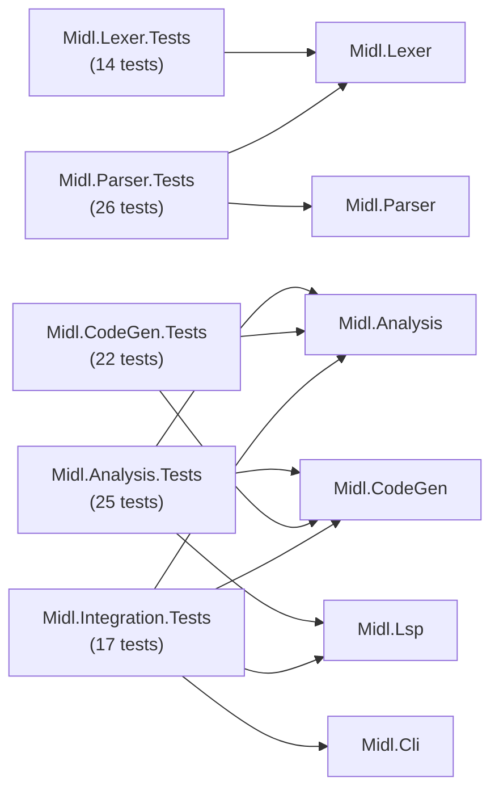
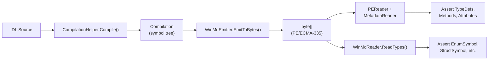

# MIDL Compiler — Testing Guide

> Comprehensive guide to running, writing, and extending tests for the MIDL compiler rewrite.

---

## 1. Quick Reference

```bash
# Run all tests
dotnet test

# Run a specific test project
dotnet test tests/Midl.Parser.Tests

# Run a specific test by name
dotnet test --filter "FullyQualifiedName~ParseNamespace"

# Run tests matching a pattern
dotnet test --filter "ErrorRecovery"

# Run with normal verbosity (shows individual test names)
dotnet test -v n

# Run with detailed output on failure
dotnet test --logger "console;verbosity=detailed"

# Run and collect code coverage
dotnet test --collect:"XPlat Code Coverage"
```

---

## 2. Test Projects Overview



### Midl.Lexer.Tests — 14 tests

Tests the tokenizer that converts raw IDL text into `SyntaxToken` sequences.

| Class | Tests | Covers |
|-------|-------|--------|
| `LexerTests` | 13 | Punctuation, operators, numeric/string literals, identifiers, keywords, comments (single-line & multi-line), whitespace trivia, error tokens, realistic MIDL3 fragments |
| `SmokeTests` | 1 | Project loads correctly |

**References:** `Midl.Lexer`

### Midl.Parser.Tests — 26 tests

Tests the Roslyn-style green-tree parser that produces lossless syntax trees.

| Class | Tests | Covers |
|-------|-------|--------|
| `ParserTests` | 18 | Namespace, runtimeclass with members, interface with `requires`, struct, enum (with bitwise expressions), delegate, attributes, versioned blocks, import directive, dotted namespaces, generic type references, apicontract, static methods, **error recovery** (missing braces, incomplete declarations, invalid tokens) |
| `ClassicMidlTests` | 7 | Classic MIDL2 constructs — coclass, cpp_quote, typedef, classic `[object]` interfaces with `[in]/[out]` parameters, library blocks, mixed MIDL2+MIDL3, pointer types |
| `SmokeTests` | 1 | Project loads correctly |

**References:** `Midl.Lexer`, `Midl.Parser`

### Midl.Analysis.Tests — 25 tests

Tests semantic analysis: symbol binding, type resolution, diagnostics, go-to-definition, and WinMD reading.

| Class | Tests | Covers |
|-------|-------|--------|
| `BinderTests` | 14 | Namespace binding (simple & nested), runtimeclass members (constructors, methods, properties, events, modifiers), interfaces, structs, enums, qualified/shorthand type resolution, diagnostics (`MIDL1001` undefined type, `MIDL1002` duplicate), `GetTypeByName`, `GetAllTypes` |
| `GotoDefinitionTests` | 3 | Go-to-definition for runtimeclass types, interfaces, and unresolved symbols |
| `WinMdReaderTests` | 7 | Round-trip: emit WinMD → read back enums, structs, interfaces, runtimeclasses; resolve types from `.winmd` references; `IsExternal` flag verification |
| `SmokeTests` | 1 | Project loads correctly |

**References:** `Midl.Analysis`, `Midl.CodeGen`, `Midl.Lsp`

### Midl.CodeGen.Tests — 22 tests

Tests all code-generation backends: WinMD, C/C++ header, IID, and dlldata.

| Class | Tests | Covers |
|-------|-------|--------|
| `WinMdEmitterTests` | 7 | ECMA-335 metadata for enums (including `[flags]`), structs, interfaces, runtimeclasses (with synthesized interfaces, `ActivatableAttribute`), delegates, emit-to-file round-trip |
| `HeaderEmitterTests` | 7 | C/C++ header generation — enums, structs, interfaces (`MIDL_INTERFACE`), runtimeclass activation strings, include guards, full WinRT type mapping (Int16→INT16, String→HSTRING, etc.) |
| `IidEmitterTests` | 5 | IID `DEFINE_GUID` output, CLSID for runtimeclasses, `extern "C"` guards, skipping interfaces without `[uuid]` |
| `DllDataEmitterTests` | 2 | dlldata.c skeleton with `DLLDATA_ROUTINES`, `REGISTER_PROXY_DLL`, rpcproxy includes |
| `SmokeTests` | 1 | Project loads correctly |

**References:** `Midl.CodeGen`, `Midl.Analysis`

### Midl.Integration.Tests — 17 tests

End-to-end tests spanning the full pipeline: CLI parsing, compilation, LSP handlers, formatting.

| Class | Tests | Covers |
|-------|-------|--------|
| `CommandLineParserTests` | 9 | CLI option parsing (`/winrt`, `/h`, `/D`, `/W3`, `/WX`, `@responsefile`, `/reference`, `/?`, `/Zs`), end-to-end `CompilationDriver.CompileToHeader`, unknown switch handling |
| `FormattingTests` | 4 | Indentation normalization, idempotent formatting, comma spacing, colon spacing |
| `SemanticTokensTests` | 3 | LSP semantic token delta encoding — keyword classification, type classification, method identifier classification |
| `ReferenceTests` | 1 | Compile IDL with `.winmd` reference, resolve external types |
| `SmokeTests` | — | (shares file with `CommandLineParserTests`) |

**References:** `Midl.Cli`, `Midl.Lsp`, `Midl.Analysis`, `Midl.CodeGen`

---

## 3. Test Tiers

| Tier | Scope | Description | When Run | Status |
|------|-------|-------------|----------|--------|
| **T0** | Unit | Per-project xUnit tests (this guide) | Every PR | ✅ Implemented |
| **T1** | Internal corpus | MidlRT test IDL files from `midlrt/test/` | Every PR | 🔲 Future |
| **T2** | Product IDLs | Real Windows OS `.idl` files from `onecoreuap\` | Nightly | 🔲 Future |
| **T3** | Golden-file | Binary-compare `.winmd`/`.h` output against `midl.exe` reference output | Nightly | 🔲 Future |
| **T4** | Drop-in | Replace `midl.exe` in a razzle build and verify the build succeeds | Milestone | 🔲 Future |

**Current status:** T0 is fully implemented with 104 tests across 5 projects. T1–T4 are future work pending test corpus collection from the Windows build. The `tests/fixtures/` and `tests/golden/` directories are placeholders for T1–T3 test data.

---

## 4. Writing Tests — By Layer

### Lexer Tests

Test the `Lexer` class that tokenizes raw IDL source into `SyntaxToken` sequences.

**Pattern:**
```csharp
var lexer = new Lexer(source);
var tokens = lexer.Lex();

// Check token kinds
Assert.Equal(SyntaxKind.NamespaceKeyword, tokens[0].Kind);

// Check token text
Assert.Equal("Bookstore", tokens[1].Text);

// Check trivia (whitespace, comments attached to tokens)
Assert.Contains(tokens[0].LeadingTrivia,
    t => t.Kind == SyntaxKind.WhitespaceTrivia);
Assert.Contains(tokens[0].TrailingTrivia,
    t => t.Kind == SyntaxKind.SingleLineCommentTrivia);

// Last token is always EOF
Assert.Equal(SyntaxKind.EndOfFileToken, tokens[^1].Kind);
```

**What to test:**
- Token kinds for all keywords, punctuation, and operators
- Token `.Text` matches the original source span
- Trivia attachment (leading vs. trailing, whitespace, comments)
- Error tokens for invalid characters (`@`, `$`)
- Unterminated strings → `SyntaxKind.ErrorToken`
- Hex numeric literals (`0xFF`)

### Parser Tests

Test the Roslyn-style green-tree parser. The parser uses a `TokenBuilder` to construct token lists directly (bypassing the lexer), or `ParseText()` to lex+parse from source.

**Pattern (using TokenBuilder):**
```csharp
var tokens = new TokenBuilder()
    .Keyword(SyntaxKind.NamespaceKeyword)
    .Identifier("MyApp")
    .OpenBrace
    .Keyword(SyntaxKind.RuntimeclassKeyword)
    .Identifier("Widget")
    .OpenBrace
    .CloseBrace
    .CloseBrace
    .EOF
    .Build();

var parser = new Parser(tokens);
var tree = parser.Parse();

Assert.Equal(SyntaxKind.CompilationUnit, tree.Kind);

// Navigate green tree children by slot index or kind
var ns = FindChild(tree, SyntaxKind.NamespaceDeclaration);
Assert.NotNull(ns);
var rc = FindChild(ns, SyntaxKind.RuntimeClassDeclaration);
Assert.NotNull(rc);
```

**Pattern (from source, used in `ClassicMidlTests`):**
```csharp
var lexer = new Lexer(source);
var tokens = lexer.Lex();
var parser = new Parser(tokens);
var tree = parser.Parse();
```

**What to test:**
- Tree structure for every syntax construct (namespace, runtimeclass, interface, struct, enum, delegate, apicontract, import, attributes, versioned blocks)
- Classic MIDL2 constructs (coclass, library, typedef, cpp_quote, pointer types)
- Error recovery — the parser must **never throw** (see [§5](#5-error-recovery-testing))
- Lossless round-trip (all source bytes are preserved in tokens + trivia)

### Analysis Tests

Test the semantic model: symbol binding, type resolution, and diagnostics.

**Pattern:**
```csharp
var compilation = CompilationHelper.Compile("""
    namespace Foo
    {
        runtimeclass Bar { }
    }
    """);

// No diagnostics for valid IDL
Assert.Empty(compilation.Diagnostics);

// Navigate the symbol tree
var fooNs = compilation.GlobalNamespace.ChildNamespaces["Foo"];
var bar = fooNs.Members.OfType<RuntimeClassSymbol>().Single();
Assert.Equal("Bar", bar.Name);
Assert.Equal("Foo.Bar", bar.FullName);
```

**Compiling with WinMD references:**
```csharp
var compilation = CompilationHelper.Compile(source, new[] { "/path/to/ref.winmd" });
```

**Checking diagnostics:**
```csharp
var diag = Assert.Single(compilation.Diagnostics);
Assert.Equal("MIDL1001", diag.Code);      // Undefined type
Assert.Contains("NoSuchType", diag.Message);
Assert.Equal(DiagnosticSeverity.Error, diag.Severity);
```

**What to test:**
- Namespace binding (simple, nested, dotted)
- All member types: constructors, methods, properties, events, fields
- Modifiers (`static`, `unsealed`, etc.)
- Type resolution (qualified names, shorthand resolution)
- Diagnostics: `MIDL1001` (undefined type), `MIDL1002` (duplicate definition)
- WinMD reader round-trips (see [§6](#6-winmd-round-trip-testing))
- `IsExternal` flag on types from `.winmd` references

### CodeGen Tests

Test all four code-generation backends.

**WinMD Emitter pattern:**
```csharp
// Compile and emit
var compilation = CompilationHelper.Compile(source);
Assert.Empty(compilation.Diagnostics);
var emitter = new WinMdEmitter();
var bytes = emitter.EmitToBytes(compilation);

// Read ECMA-335 metadata
var peReader = new PEReader(new MemoryStream(bytes));
var reader = peReader.GetMetadataReader();

// Assert on TypeDefs
var handle = FindTypeDef(reader, "Color");
var td = reader.GetTypeDefinition(handle);
Assert.Equal("Test", reader.GetString(td.Namespace));
Assert.True(td.Attributes.HasFlag(TypeAttributes.Public));

// Assert on fields, methods, custom attributes
Assert.True(HasCustomAttribute(reader, handle, "System.FlagsAttribute"));
```

**Header Emitter pattern:**
```csharp
var compilation = CompilationHelper.Compile(source);
var emitter = new HeaderEmitter();
var header = emitter.Emit(compilation);

Assert.Contains("MIDL_INTERFACE(", header);
Assert.Contains("#pragma once", header);
Assert.Contains("INT32 X;", header);
```

**IID Emitter pattern:**
```csharp
var emitter = new IidEmitter();
var output = emitter.Emit(compilation);
Assert.Contains("IID_IMyInterface", output);
Assert.Contains("0x12345678", output);
```

**What to test:**
- WinMD: correct ECMA-335 encoding, type flags (Public, Sealed, WindowsRuntime), base types (System.Enum, System.ValueType, System.Object, System.MulticastDelegate), field attributes, method attributes, custom attributes (`GuidAttribute`, `ActivatableAttribute`, `FlagsAttribute`), constant values, synthesized interfaces for runtimeclasses, InterfaceImpl entries
- Header: include guards, MIDL_INTERFACE macros, WinRT type mappings, activation strings
- IID: DEFINE_GUID formatting, extern "C" guards, CLSID vs. IID, skip when no `[uuid]`
- DllData: DLLDATA_ROUTINES, rpcproxy includes

### Integration Tests

Test the full pipeline from CLI arguments to output.

**CLI parsing pattern:**
```csharp
var args = new[] { "/winrt", "/h", "output.h", "/out", "dir", "input.idl" };
var options = CommandLineParser.Parse(args);
Assert.True(options.WinRtMode);
Assert.Equal("output.h", options.HeaderFile);
```

**End-to-end compilation:**
```csharp
var header = CompilationDriver.CompileToHeader(source);
Assert.NotNull(header);
Assert.Contains("Widget", header);
```

**LSP handler tests:**
```csharp
// Semantic tokens
var (data, tokenTypes, _) = SemanticTokensHandler.HandleCore(source);
int keywordIdx = Array.IndexOf(tokenTypes, "keyword");
Assert.Equal(keywordIdx, data[3]); // first token type

// Formatting
var formatted = FormattingHandler.Format(input);
Assert.Contains("    runtimeclass Widget", formatted);

// Go-to-definition
var result = GotoDefinitionHandler.HandleCore(source, uri, line, char);
Assert.NotNull(result);
```

**What to test:**
- CLI option parsing (all switches, response files, unknown switch handling)
- End-to-end `CompileToHeader`
- LSP semantic tokens (delta encoding, token type classification)
- LSP formatting (indentation, comma/colon spacing, idempotency)
- LSP go-to-definition (type references, interface references, unresolved)
- Cross-file `.winmd` reference resolution

---

## 5. Error Recovery Testing

The parser is designed for IDE scenarios and must **never throw an exception**, regardless of input. It always produces a `CompilationUnit` green tree.

**Key invariants to test:**

1. **Tree is always returned** — `Assert.Equal(SyntaxKind.CompilationUnit, tree.Kind)`
2. **Structural nodes survive** — key declarations are still present even with missing tokens
3. **`MissingToken` marks errors** — incomplete input produces `MissingToken` nodes
4. **`SkippedTokens` marks garbage** — unrecognized tokens are wrapped in `SkippedTokens`

**Pattern — missing closing braces:**
```csharp
var tokens = new TokenBuilder()
    .Keyword(SyntaxKind.NamespaceKeyword)
    .Identifier("MyApp")
    .OpenBrace
    .Keyword(SyntaxKind.RuntimeclassKeyword)
    .Identifier("Widget")
    .OpenBrace
    .Keyword(SyntaxKind.VoidKeyword)
    .Identifier("DoThing")
    .OpenParen.CloseParen.Semicolon
    .EOF  // missing } }
    .Build();

var tree = Parse(tokens);
Assert.Equal(SyntaxKind.CompilationUnit, tree.Kind);

// Namespace and runtimeclass are still present
var ns = FindChild(tree, SyntaxKind.NamespaceDeclaration);
Assert.NotNull(ns);
var rc = FindChild(ns, SyntaxKind.RuntimeClassDeclaration);
Assert.NotNull(rc);
```

**Pattern — incomplete declaration (mid-typing):**
```csharp
var tokens = new TokenBuilder()
    .Keyword(SyntaxKind.RuntimeclassKeyword)
    .EOF  // user stopped typing
    .Build();

var tree = Parse(tokens);
Assert.Equal(SyntaxKind.CompilationUnit, tree.Kind);

var rc = FindChild(tree, SyntaxKind.RuntimeClassDeclaration);
Assert.NotNull(rc);

// Should have MissingToken children for name and braces
bool hasMissing = false;
for (int i = 0; i < rc.SlotCount; i++)
{
    if (rc.GetSlot(i)?.Kind == SyntaxKind.MissingToken)
    {
        hasMissing = true;
        break;
    }
}
Assert.True(hasMissing, "Incomplete declaration should have MissingToken nodes");
```

**Pattern — invalid tokens in attribute list:**
```csharp
var tokens = new TokenBuilder()
    .OpenBracket
    .Identifier("invalid")
    .Token(SyntaxKind.ErrorToken, "$")
    .Identifier("stuff")
    .CloseBracket
    .Keyword(SyntaxKind.RuntimeclassKeyword)
    .Identifier("Foo")
    .OpenBrace.CloseBrace
    .EOF
    .Build();

var tree = Parse(tokens);
Assert.Equal(SyntaxKind.CompilationUnit, tree.Kind);
// Runtimeclass still parses after recovering from the error token
var rc = FindChild(tree, SyntaxKind.RuntimeClassDeclaration);
Assert.NotNull(rc);
```

---

## 6. WinMD Round-Trip Testing

WinMD round-trip testing validates both the emitter and reader by writing and reading back metadata.



**Emitter → MetadataReader (CodeGen tests):**
```csharp
var bytes = CompileAndEmit(source);
var reader = CreateReader(bytes, out var pe);
using (pe)
{
    var handle = FindTypeDef(reader, "Color");
    var td = reader.GetTypeDefinition(handle);
    Assert.Equal("Test", reader.GetString(td.Namespace));
    // ... assert fields, methods, attributes, constants
}
```

**Emitter → WinMdReader (Analysis tests):**
```csharp
var winmd = EmitWinMd(source);
var reader = new WinMdReader();
var types = reader.ReadTypes(winmd);

var enumSymbol = types.OfType<EnumSymbol>().FirstOrDefault(e => e.Name == "MyColor");
Assert.NotNull(enumSymbol);
Assert.Equal("TestNs.MyColor", enumSymbol.FullName);
Assert.True(enumSymbol.IsExternal);
Assert.Equal(3, enumSymbol.EnumMembers.Count);
```

**Cross-reference resolution:**
```csharp
// Emit a .winmd with types, write to temp file
var winmd = EmitWinMd(refSource);
File.WriteAllBytes(tempPath, winmd);

// Compile IDL that references the external types
var compilation = CompilationHelper.Compile(appSource, new[] { tempPath });
Assert.False(compilation.Diagnostics.Any(d => d.Severity == DiagnosticSeverity.Error));

// External types resolve and are marked IsExternal=true
var externalType = compilation.GetTypeByName("External.StatusCode");
Assert.NotNull(externalType);
Assert.True(externalType.IsExternal);
```

---

## 7. Building and Testing the VS Code Extension

### Prerequisites

- **Node.js 18+** and npm
- **VS Code** (1.85.0+)
- **.NET 10 SDK** (10.0.102) — for building the LSP server

### Building the Extension

```bash
cd editors/vscode

# Install dependencies
npm install

# Compile TypeScript to JavaScript
npx tsc -p .

# Output goes to editors/vscode/out/extension.js
```

The extension uses a `tsconfig.json` at the root of `editors/vscode/`:

```json
{
  "compilerOptions": {
    "target": "ES2020",
    "module": "commonjs",
    "lib": ["ES2020"],
    "outDir": "./out",
    "rootDir": "./src",
    "strict": true,
    "esModuleInterop": true,
    "skipLibCheck": true
  },
  "include": ["src/**/*"]
}
```

### How the Extension Works

The extension (in `src/extension.ts`) does three things:

1. **Registers the `midl` language** for `.idl` files with a TextMate grammar (`syntaxes/midl.tmLanguage.json`)
2. **Starts a Language Server Protocol (LSP) client** that communicates with the MIDL CLI over stdio
3. **Watches `.idl` files** for changes and notifies the server

The server command is resolved from the `midl.serverPath` VS Code setting (defaults to `"midl"`), and is invoked with `--lsp`:
```
<serverPath> --lsp
```

### Running the Extension in Development

**Option 1: VS Code Extension Development Host (recommended)**
1. Open the `editors/vscode/` folder in VS Code
2. Run `npm install` in the terminal (if not done)
3. Run `npx tsc -p .` to compile
4. Press **F5** to launch the Extension Development Host
5. Open any `.idl` file in the new VS Code window

**Option 2: Manual VSIX packaging**
```bash
cd editors/vscode

# Install vsce if needed
npm install -g @vscode/vsce

# Package the extension
npx @vscode/vsce package

# Install the .vsix in VS Code
code --install-extension midl-language-0.0.1.vsix
```

### Configuring the LSP Server Path

The extension needs a running MIDL CLI binary. Set the `midl.serverPath` setting in VS Code settings (JSON):

**Option A — `dotnet run` (development):**
```json
{
    "midl.serverPath": "dotnet run --project E:/midl/src/Midl.Cli --"
}
```

**Option B — Published binary (faster startup):**
```bash
# Build the CLI
dotnet publish src/Midl.Cli -c Release -o publish/
```
```json
{
    "midl.serverPath": "E:/midl/publish/Midl.Cli.exe"
}
```

### What to Verify Manually

| # | Action | Expected Result |
|---|--------|----------------|
| 1 | Open a `.idl` file | Syntax highlighting appears (TextMate grammar) |
| 2 | Type `namespace` | Keyword is colored as a language keyword |
| 3 | Write invalid syntax (e.g., `namespace {{{`) | Red squiggly diagnostics appear |
| 4 | Type inside `runtimeclass { }` | Completion suggestions pop up |
| 5 | Hover over a type keyword (e.g., `String`) | Hover tooltip appears |
| 6 | Open Document Outline (**Ctrl+Shift+O**) | Symbols (namespaces, classes) are listed |
| 7 | Right-click a type name → **Go to Definition** | Jumps to the type's declaration |
| 8 | Type `Int32 a,String b` in a parameter list → **Format Document** | Formats to `Int32 a, String b` |

### Current Limitations

- **Full-document reparse** — the LSP server reparses the entire document on every change (no incremental parsing yet)
- **Single-file analysis** — no cross-file type resolution; each file is analyzed in isolation
- **Go-to-definition** — only resolves types defined in the same file
- **No auto-discovery of references** — `.winmd` references must be configured manually (the `/reference` flag is not auto-populated)
- **No debugging support** — no DAP integration
- **No rename/refactoring** — LSP rename provider not yet implemented

---

## 8. Adding Test Fixtures

Test fixture directories:

```
tests/
├── fixtures/     ← IDL source files for test input
├── golden/       ← Expected output files for golden-file testing (T3)
├── Midl.Lexer.Tests/
├── Midl.Parser.Tests/
├── Midl.Analysis.Tests/
├── Midl.CodeGen.Tests/
└── Midl.Integration.Tests/
```

**Naming conventions:**

| Pattern | Purpose | Example |
|---------|---------|---------|
| `FeatureName.positive.idl` | Valid IDL that should compile cleanly | `RuntimeClass.positive.idl` |
| `FeatureName.negative.idl` | Invalid IDL that should produce specific diagnostics | `RuntimeClass.negative.idl` |
| `FeatureName.expected.h` | Expected C/C++ header output | `RuntimeClass.expected.h` |
| `FeatureName.expected.winmd` | Expected WinMD binary output | `RuntimeClass.expected.winmd` |

**Future corpus locations:**
- **T1:** MidlRT test IDL files will be mirrored into `tests/fixtures/midlrt/`
- **T2:** Windows product `.idl` files will be placed in `tests/fixtures/product/`
- **T3:** Golden reference outputs (from `midl.exe`) will be placed in `tests/golden/`

---

## 9. Continuous Integration

The CI pipeline runs all T0 tests on every PR:

```bash
# Step 1: Restore NuGet packages
dotnet restore

# Step 2: Build all projects (warnings are errors)
dotnet build --no-restore

# Step 3: Run all tests
dotnet test --no-build
```

**Requirements:**
- All tests must pass — zero failures
- All warnings must be resolved (`TreatWarningsAsErrors` is enabled)
- No new `MIDL1xxx` diagnostic codes without corresponding tests

**Adding to CI for the VS Code extension (future):**
```bash
cd editors/vscode
npm ci
npx tsc -p . --noEmit   # Type-check only
# npx @vscode/vsce package  # Verify packaging works
```

---

## 10. Troubleshooting

### Common Issues

| Problem | Cause | Fix |
|---------|-------|-----|
| `Failed to load prune package data` warning | Harmless .NET 10 preview warning in `dotnet restore` | Ignore — does not affect tests |
| Tests not discovered | Test project missing xunit references | Verify `.csproj` has `xunit`, `xunit.runner.visualstudio`, and `Microsoft.NET.Test.Sdk` PackageReferences |
| `Could not load file or assembly 'Midl.Lexer'` | Missing project reference | Check `<ProjectReference>` entries in the test `.csproj` |
| LSP not connecting in VS Code | `midl.serverPath` not set or incorrect | Open Settings → search "midl.serverPath" → set to full path of CLI binary or `dotnet run` command |
| WinMD tests failing with PE format errors | Mismatched `System.Reflection.Metadata` version | Ensure all projects reference the same version via `Directory.Packages.props` |
| `error NETSDK1045: The current .NET SDK does not support targeting .NET 10.0` | Wrong SDK version | Install .NET 10 SDK 10.0.102 from the .NET preview page |
| `No test matches the given testcase filter` | Filter pattern is too specific | Use partial name: `--filter "FullyQualifiedName~PartialName"` or just `--filter "MethodName"` |
| TypeScript compilation errors in VS Code extension | Missing `node_modules` | Run `npm install` in `editors/vscode/` |
| Verify.Xunit snapshot mismatch | Snapshot files changed or missing | Delete the `.verified.` files and re-run to generate new baselines |

### Useful Diagnostic Commands

```bash
# List all discovered tests without running them
dotnet test --list-tests

# Run with full diagnostic logging
dotnet test -v d

# Run a single test class
dotnet test --filter "FullyQualifiedName~WinMdEmitterTests"

# Check SDK version
dotnet --version

# Check which test frameworks are detected
dotnet test --list-tests -v d 2>&1 | head -50
```
