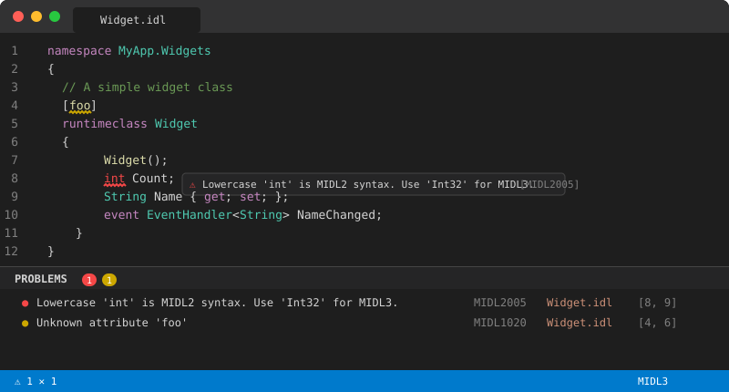
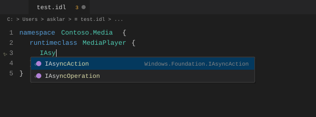
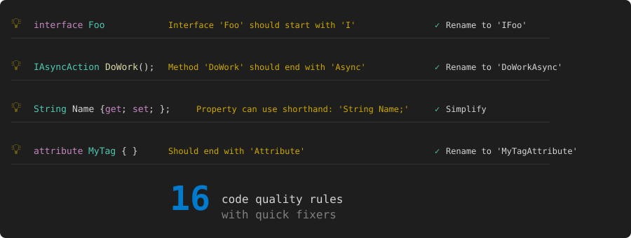
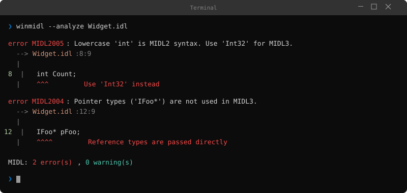
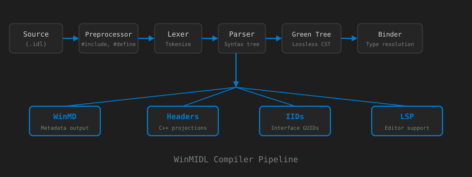

# MIDL Language Support for VS Code

**A complete MIDL3 development environment** — catch errors as you type, get context-aware completions, and ship correct WinRT APIs faster.



---

## ⚡ Real-Time Diagnostics

Errors and warnings surface instantly as you type — no build step required. Syntax errors, undefined types, MIDL2/MIDL3 migration issues, and duplicate definitions are caught with precise source locations and actionable messages.


---

## 🧠 Context-Aware IntelliSense

Completions adapt to where your cursor is. Inside an attribute bracket on a `runtimeclass`? You'll see `activatable`, `composable`, `contract`. Inside a `struct` body? Only value types that are valid there.



Includes WinRT primitives, collection/async types, external `.winmd` types, and trigger characters on `.` and space.

---

## 🎯 Code Quality

16 built-in code quality rules with one-click quick fixers — enforce WinRT naming conventions, simplify verbose patterns, and catch common mistakes.



---

## 💻 CLI Experience

Use `winmidl` from the command line for CI pipelines, pre-commit hooks, or batch analysis. Rust-style diagnostic output with source spans and fix suggestions.



---

## 🏗️ Architecture

WinMIDL is a full compiler pipeline — not just a linter. The same engine powers both the CLI and the VS Code extension via LSP.



---

## Features

### 🎨 Syntax Highlighting

Full TextMate grammar covering both MIDL3 and classic MIDL syntax:

- **Keywords** — `namespace`, `runtimeclass`, `interface`, `delegate`, `struct`, `enum`, `event`, `import`, `apicontract`, and classic keywords like `coclass`, `library`, `typedef`, `union`
- **Types** — WinRT primitives (`Boolean`, `Int32`, `String`, `Guid`, `Object`, …) and classic types (`HRESULT`, `BSTR`, `IUnknown`, `IDispatch`, …)
- **Qualified type names** — Dotted names like `Windows.Foundation.Uri` highlighted as types
- **Attributes** — Keywords inside `[...]` brackets (e.g., `uuid`, `contract`, `activatable`, `composable`, `threading`, `deprecated`, and many more)
- **GUIDs** — Inline GUID literals colorized as constants
- **Strings, numbers, comments** — Double-quoted strings with escape sequences, hex (`0xFF`) and decimal literals, line (`//`) and block (`/* */`) comments
- **Storage modifiers** — `static`, `partial`, `unsealed`, `protected`, `overridable`, `get`, `set`, `out`, `ref`, `const`

### 📝 Code Snippets

19 snippets for common MIDL3 patterns — type a prefix and press Tab:

| Prefix | Description |
|--------|-------------|
| `namespace` | Namespace declaration |
| `runtimeclass` | Runtime class with default constructor |
| `unsealedruntimeclass` | Unsealed (composable) runtime class with base class |
| `staticruntimeclass` | Static-only runtime class |
| `interface` | Interface declaration |
| `interfacerequires` | Interface with `requires` clause |
| `delegate` | Delegate type |
| `struct` | Struct with fields |
| `enum` | Enumeration |
| `flagsenum` | Flags enumeration with `[flags]` attribute |
| `propget` | Read-only property (`{ get; }`) |
| `proprw` | Read-write property (shorthand) |
| `event` | Typed event (`TypedEventHandler`) |
| `asyncmethod` | Async method returning `IAsyncOperation<T>` |
| `asyncaction` | Async method returning `IAsyncAction` |
| `contract` | Contract version attribute |
| `apicontract` | API contract definition with `[contractversion]` |
| `versionedblock` | Versioned member block with contract attribute |
| `import` | Import directive |

### 🖱️ Hover Information

Hover over any token for contextual documentation — keywords, built-in types, user-defined types, and external `.winmd` symbols.

### 🔗 Go to Definition

**Ctrl+Click** or **F12** on any type or member name to jump to its declaration.

### 🔎 Find All References

**Shift+F12** to find every usage of a symbol in the document.

### ✍️ Signature Help

Parameter hints triggered by `(` and `,` — shows full method/constructor/delegate signatures with active parameter highlighting.

### 🎯 Semantic Highlighting

14 semantic token types with declaration/static modifiers — identifiers resolved against the compilation for precise highlighting.

### 📐 Document Formatting

**Shift+Alt+F** — consistent 4-space indentation, normalized spacing, blank lines between declarations, trailing whitespace cleanup.

### 📋 Document Outline

Hierarchical symbol tree in **Outline** view and **Breadcrumbs** — namespaces, types, and members.

### 📄 Language Configuration

Comment toggling, bracket matching, auto-closing pairs, smart indentation, and doc comment continuation — all configured out of the box.

---

## Configuration

| Setting | Type | Default | Description |
|---------|------|---------|-------------|
| `midl.serverPath` | `string` | `"midl"` | Path to the MIDL CLI executable. The extension launches this with `--lsp` to start the language server over stdio. |

---

## Getting Started

### 1. Install the Extension

Install **MIDL Language Support** from the VS Code marketplace or from a `.vsix` package.

### 2. Build the MIDL Compiler

```bash
cd E:\midl
dotnet build
```

### 3. Configure the Server Path

Open VS Code settings (**Ctrl+,**) and set the path to the compiled MIDL CLI binary:

```json
{
    "midl.serverPath": "E:\\midl\\src\\Midl.Cli\\bin\\Debug\\net10.0\\Midl.Cli.exe"
}
```

### 4. Open a `.idl` File

The extension activates automatically when you open any `.idl` file. All features — syntax highlighting, diagnostics, completions, hover, and more — are available immediately.

---

## Requirements

- **.NET 10 SDK** — Required to build and run the MIDL language server
- **VS Code 1.85+** — Minimum supported VS Code version

---

## Known Limitations

- **Single-file analysis** — The language server analyzes each file independently; cross-file imports are not yet resolved in the LSP
- **Go to Definition** — Works within the current file only; external `.winmd` types cannot be navigated to
- **Full document sync** — The entire document is re-sent and reparsed on every keystroke (incremental text sync planned)
- **No rename/refactoring** — Symbol rename and code actions are not yet implemented
- **No code folding from LSP** — Folding relies on the regex-based language configuration, not semantic ranges
- **External type completions** — `.winmd` files are only discovered in the same directory as the open file

---

## Development

To work on the extension itself:

1. Open `E:\midl\editors\vscode` in VS Code
2. Run `npm install` to install dependencies
3. Press **F5** to launch the Extension Development Host (uses the `Launch Extension` debug configuration)
4. Edit `.idl` files in the new window to test

### Building

```bash
npm run compile    # One-time TypeScript build
npm run watch      # Watch mode for development
npm run package    # Package as .vsix
```

---

## License

See the [repository](https://github.com/microsoft/midl) for license information.
